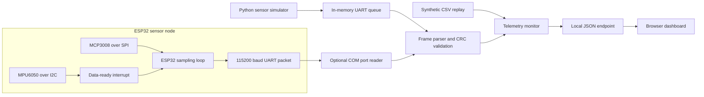

# Embedded Systems & Sensor Monitoring Platform

A Windows-runnable sensor telemetry lab with a live local web dashboard, deterministic sensor simulation, replayable example data, and an ESP32 Arduino/PlatformIO firmware target. The Python simulator and firmware share the same binary UART packet format, so the receive, checksum, alarm, and dashboard paths can be exercised without physical hardware.

> **Portfolio project:** The supplied measurements are synthetic, and the ESP32 sketch is a hardware-targeted example. This repository does not claim that the firmware was compiled or tested on physical hardware.

## Features

- Simulate temperature and vibration sensors with seeded measurement noise and a visible threshold event.
- Encode/decode a fixed-width UART telemetry packet with CRC-16/CCITT integrity checking and stream resynchronization.
- Serve a live dashboard and JSON status endpoint from Python's standard-library HTTP server.
- Replay synthetic CSV telemetry or optionally receive binary frames from a physical COM port with PySerial.
- Track packet loss, out-of-order frames, malformed frames, bounded history, and temperature/vibration alarms.
- Provide ESP32 firmware examples for I2C (MPU6050), SPI (MCP3008), UART telemetry, and a data-ready interrupt.
- Bind the dashboard to loopback by default; no telemetry is sent to an external service.

## Requirements and Windows setup

- Python 3.10 or later for the simulator, tests, and dashboard.
- A network connection is not needed for the simulator once Python is available; its application dependencies are Python standard-library modules.
- PlatformIO Core is needed to build the ESP32 firmware. It was not available in the implementation environment.
- Physical hardware is optional. The COM-port mode needs `pyserial` and a USB-to-UART connection.

From PowerShell in this repository:

```powershell
py -3.10 -m venv .venv
.\.venv\Scripts\python.exe -m pip install -e .
.\.venv\Scripts\python.exe -m sensor_monitor --port 8765
```

Open [http://127.0.0.1:8765](http://127.0.0.1:8765) in a browser and stop with `Ctrl+C`. The command binds to localhost by default. Use an explicit `--host` only on a trusted network; the dashboard has no user authentication or TLS.

Virtual environment activation is not required (and may be blocked by a restrictive PowerShell script policy); run its `python.exe` directly as shown above. For an offline source-tree run without installing the package, use:

```powershell
Set-Location src
python -m sensor_monitor --port 8765
```

## Run the examples

Start the live simulator:

```powershell
.\.venv\Scripts\python.exe -m sensor_monitor
```

Replay the included 80-row synthetic trace:

```powershell
.\.venv\Scripts\python.exe -m sensor_monitor --replay examples\data\sensor_telemetry.csv
```

Regenerate the example data:

```powershell
python examples\generate_telemetry.py
```

To connect a flashed ESP32 over a USB serial COM port, install the optional dependency and choose the port shown by Device Manager:

```powershell
.\.venv\Scripts\python.exe -m pip install -e ".[serial]"
.\.venv\Scripts\python.exe -m sensor_monitor --serial-port COM4
```

The serial receiver expects 115200 baud and the packet format below. Close Arduino Serial Monitor before starting the application because only one process can own a COM port at a time.

## Tests

```powershell
.\.venv\Scripts\python.exe -m unittest discover -s tests -v
```

The suite exercises packet framing/CRC, byte-stream resynchronization, data validation, simulator repeatability, packet-loss and alarm accounting, sample-data replay, and the local HTTP dashboard endpoints.

## Architecture



| Component | Responsibility |
|---|---|
| `protocol.py` | Packet field encoding, CRC-16/CCITT, byte-stream frame recovery |
| `simulator.py` | Seeded virtual sensors and in-memory UART frame producer |
| `serial_link.py` | Optional COM-port reader using PySerial |
| `replay.py` | Strictly validated CSV replay loader |
| `monitor.py` | Thread-safe history, packet diagnostics, alarms, dashboard snapshot |
| `dashboard.py` | Local HTTP server, JSON endpoints, real-time chart UI |
| `app.py` | CLI, source selection, thread/server lifecycle, error reporting |
| `firmware/esp32_monitor/` | ESP32 Arduino sketch and PlatformIO target |

## UART packet format

All integer fields are little-endian. The 12-byte frame is:

| Offset | Size | Field | Encoding |
|---:|---:|---|---|
| 0 | 2 | Sync marker | ASCII `SM` |
| 2 | 4 | Sequence | Unsigned 32-bit counter |
| 6 | 2 | Temperature | Signed centi-degrees Celsius |
| 8 | 2 | Vibration | Unsigned milli-g |
| 10 | 2 | Checksum | CRC-16/CCITT-FALSE over bytes 0–9 |

The sequence counter wraps from `0xFFFFFFFF` to zero. The parser accepts partial serial reads, discards bytes before the sync marker, and advances by one byte after a corrupt candidate so it can recover a later frame.

## Firmware wiring guide

The firmware is configured for a common ESP32 DevKit, MPU6050, MCP3008, and analog vibration sensor. Confirm pin assignments and voltage limits for your exact board and modules.

| Signal | ESP32 | Device |
|---|---|---|
| I2C SDA / SCL | GPIO 21 / 22 | MPU6050 SDA / SCL, address `0x68` |
| Data-ready interrupt | GPIO 4 | MPU6050 INT |
| SPI MOSI / MISO / SCK | GPIO 23 / 19 / 18 | MCP3008 DIN / DOUT / CLK |
| SPI chip select | GPIO 5 | MCP3008 CS/SHDN |
| Analog vibration output | — | MCP3008 CH0; keep input within its configured reference range |
| UART telemetry | USB serial / UART0, 115200 | Host COM port |
| Diagnostics UART | GPIO 17 TX / GPIO 16 RX | Optional second USB-UART adapter |

Use a common ground. The sketch uses an example 1.65 V bias and 0.300 V/g sensitivity for its analog vibration conversion; calibrate those values for the sensor you actually connect. An MCP3008 input must not exceed its reference voltage. GPIO 5 is a boot-strapping pin on common ESP32 modules, so ensure the attached chip-select circuit does not force an invalid boot level.

Build from `firmware/esp32_monitor` with PlatformIO Core:

```powershell
pio run
pio run -t upload
```

## Engineering background

### Sensor acquisition and interrupts

I2C is a clocked two-wire bus suited to register-based sensors such as the MPU6050. The sketch reads the accelerometer and temperature registers after a data-ready edge. The interrupt service routine only sets a flag; bus I/O is deferred to the main loop because I2C/SPI transactions and serial output do not belong in an ISR.

SPI uses separate clock, controller-out, controller-in, and chip-select signals. The MCP3008 conversion is initiated with a three-byte command for channel 0. The ADC result is converted from counts to volts, then to a vibration proxy using the sensor bias and sensitivity calibration.

### UART framing and integrity

UART is a byte stream; a read call is not guaranteed to align with a packet. The `SM` marker, fixed frame length, sequence counter, and checksum allow the receiver to recover boundaries and detect corruption. CRC-16/CCITT-FALSE uses polynomial `0x1021` and initial state `0xFFFF`; it detects common transmission errors but is not encryption or authentication.

### Telemetry alarms

The dashboard uses example threshold limits of 60 °C and 0.5 g. These are demonstration settings, not safety limits. Packet-loss count is calculated from sequence gaps modulo 32 bits; out-of-order or duplicate frames are counted separately. History is bounded to avoid unbounded memory growth.

## Experiments

1. Compare `--replay` with the live simulator; inspect how the alarm at sequence 12 appears in the event table.
2. Corrupt one encoded frame and confirm the invalid-frame counter increases while later frames are still processed.
3. Drop a sequence number in a test replay and observe packet-loss accounting.
4. Change the seeded sensor noise or threshold in `TelemetryMonitor` and rerun tests.
5. Feed UART data in one-byte chunks to exercise parser resynchronization.
6. Connect the specified hardware, calibrate the vibration sensor, then compare physical readings with the simulator. No hardware test is claimed by this project.

## Limitations and next steps

- Synthetic readings are generated for demonstration and are not measurements from HAW Hamburg labs or real equipment.
- The firmware's ADC bias/sensitivity must be calibrated; the current example values are not universal.
- The dashboard keeps data in memory and does not persist history or provide user authentication.
- The Python app and firmware have not been validated together on physical ESP32 hardware in this environment.
- Future work could add persistent storage, configurable sensor profiles, reconnect/backoff for serial loss, and protocol version negotiation.

## Technical interview questions and answers

1. **Why keep the interrupt handler short?** ISRs should have predictable, low latency. This one records that data is ready and lets the main loop perform slower bus and serial work.
2. **What is the difference between I2C and SPI?** I2C shares a two-wire addressed bus; SPI uses separate data directions and usually one chip-select per peripheral, giving higher throughput with more pins.
3. **Why is UART not message-oriented?** UART transports an ordered byte stream without packet boundaries; sync, length, sequence, and CRC must be defined by the application protocol.
4. **What does the CRC provide?** It detects many accidental bit errors. It does not encrypt the data, identify a trusted sender, or prevent deliberate modification.
5. **How is temperature represented on the wire?** As a signed 16-bit integer in centi-degrees Celsius; the decoder divides by 100, trading precision for a compact fixed-width field.
6. **How does the receiver detect a missing packet?** It compares each sequence number with the previous number modulo 32 bits and accumulates positive forward gaps.
7. **Why use an in-memory UART queue in simulation?** It exercises the same encoder, frame parser, CRC validation, monitor, and dashboard without claiming physical serial hardware was tested.
8. **Why use a bounded history?** It keeps memory use predictable during a long-running dashboard process.
9. **What does the vibration conversion assume?** A calibrated analog sensor with known bias and volts-per-g sensitivity, connected within ADC voltage limits; different sensors need different values.
10. **What would you add before deploying this monitor?** Sensor-specific calibration, persistent storage, reconnect behavior, access control/TLS for non-loopback use, and hardware-in-loop verification.

## License

MIT. See [LICENSE](LICENSE).
